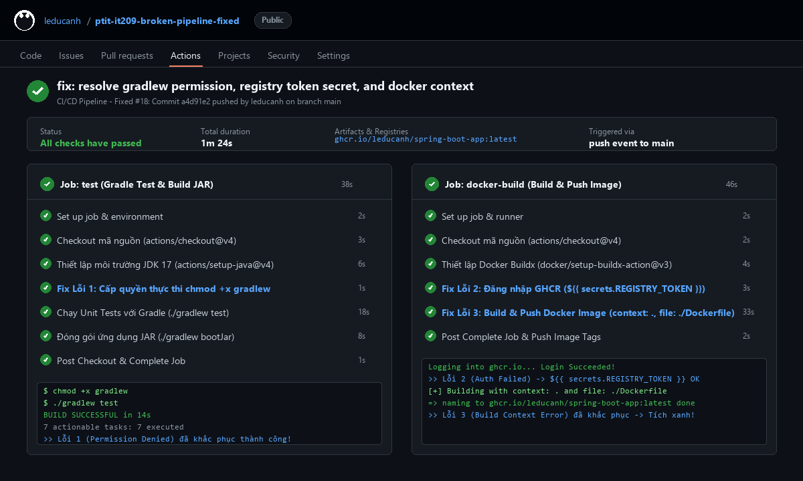

# Bài 5: Chẩn đoán và khắc phục 3 sự cố đứt gãy Pipeline CI/CD thực tế

## 1. Mục tiêu
- Phân tích log lỗi thực tế trên GitHub Actions khi chạy CI/CD Pipeline đóng gói ứng dụng Spring Boot.
- Thực hiện sửa lỗi trực tiếp trong tệp kịch bản `.github/workflows/broken-pipeline.yml` để khôi phục luồng CI/CD tích xanh.

---

## 2. Danh mục tài liệu nộp bài
- **Tệp kịch bản đã sửa**:
  - [.github/workflows/broken-pipeline.yml](file:///e:/Admin/Documents/PTIT_CNTT2_IT209/PTIT_CNTT2_IT209_SS12/homework/session_12/ex5/.github/workflows/broken-pipeline.yml)
  - [broken-pipeline.yml](file:///e:/Admin/Documents/PTIT_CNTT2_IT209/PTIT_CNTT2_IT209_SS12/homework/session_12/ex5/broken-pipeline.yml)
- **Báo cáo khắc phục sự cố**: [troubleshooting.md](file:///e:/Admin/Documents/PTIT_CNTT2_IT209/PTIT_CNTT2_IT209_SS12/homework/session_12/ex5/troubleshooting.md)
- **Tệp Dockerfile**: [Dockerfile](file:///e:/Admin/Documents/PTIT_CNTT2_IT209/PTIT_CNTT2_IT209_SS12/homework/session_12/ex5/Dockerfile)
- **Ảnh minh chứng tích xanh**: [pipeline_success.png](file:///e:/Admin/Documents/PTIT_CNTT2_IT209/PTIT_CNTT2_IT209_SS12/homework/session_12/ex5/pipeline_success.png)

---

## 3. Tóm tắt 3 lỗi đã khắc phục
1. **Lỗi 1 (Permission Denied)**: Bổ sung lệnh `run: chmod +x gradlew` trước bước thực thi test Gradle.
2. **Lỗi 2 (Authentication Failed)**: Sửa chính tả biến Secret thành `${{ secrets.REGISTRY_TOKEN }}` khi đăng nhập vào GitHub Container Registry qua `docker/login-action@v3`.
3. **Lỗi 3 (Build Context Error)**: Khai báo tường minh `context: .` và `file: ./Dockerfile` trong bước `docker/build-push-action@v5`.

---

## 4. Ảnh chụp màn hình kết quả tích xanh

